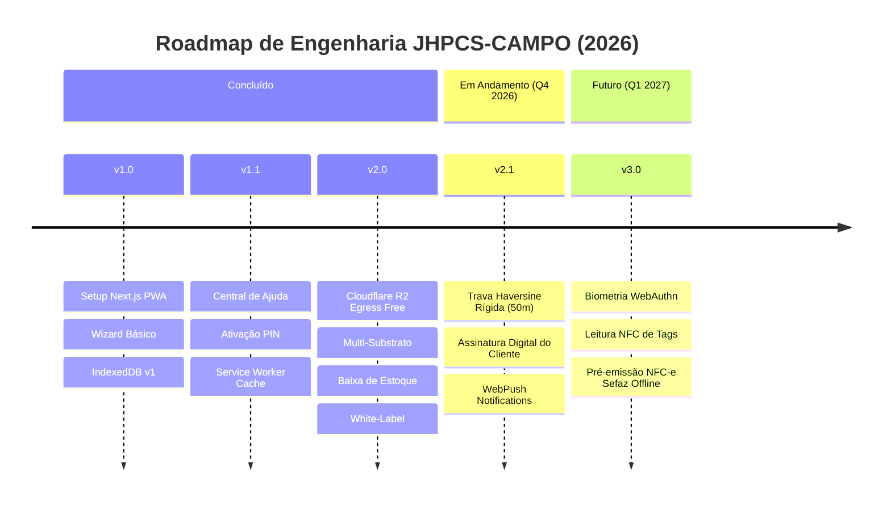

# 🗺️ Roadmap Estratégico & Técnico (JHPCS-CAMPO)
**JHoston Pools Control System • Aplicativo Móvel PWA**

---

## 🎯 Visão do Produto
O **JHPCS-CAMPO** é o terminal móvel offline-first projetado para garantir que todo atendimento químico e físico em piscinas seja executado com máxima velocidade pelo técnico, respaldado por telemetria satelital (GPS), fotos periciais e cálculo estequiométrico automatizado.

---

## 📅 Linha do Tempo & Sprints

---

## 🚀 Fases e Metas Detalhadas

### ✅ Fase 1: Fundação do PWA e Resiliência de Campo (CONCLUÍDO - v1.0 / v1.1)
- [x] Repositório isolado e focado exclusivamente na experiência de campo móvel.
- [x] Login rápido por CPF + PIN de 4 dígitos sem exigência de senhas longas.
- [x] Armazenamento de atendimentos no IndexedDB quando não houver sinal 4G.
- [x] Sincronização automática para `/api/maintenance/submit` ao restabelecer rede.
- [x] Central de Ajuda interativa com FAQ e manuais operacionais.

### ✅ Fase 2: Eficiência de Mídia, Multi-Material & White-Label (CONCLUÍDO - v2.0)
- [x] Migração de armazenamento de evidências para o Cloudflare R2 com custo zero de saída.
- [x] Compressão de imagens WebP em hardware local (Canvas) antes de transmitir.
- [x] Seletor de substratos (Monolítico, Fibra, Vinil, Pastilha, Alvenaria) com advertências específicas.
- [x] Catálogo de insumos da caminhonete com baixa automática de estoque.
- [x] Perfil comercial White-Label do tratador com disparo formatado no WhatsApp.

### 🟡 Fase 3: Governança Pericial e Assinatura Digital (CONCLUÍDO - v2.1 / v2.2)
- [x] **Geofencing Haversine Rígido (50m)**:
  - Comparação da coordenada do celular via `navigator.geolocation` (`enableHighAccuracy: true`, `maximumAge: 0`) com a piscina cadastrada.
  - Bloqueio de finalização se a distância for superior a 50 metros, exigindo justificativa pericial formal com registro de flag no laudo.
- [x] **Assinatura Digital do Cliente na Tela**:
  - Subcomponente em Canvas touch (`CanvasSignatureModal.tsx`) para assinatura do proprietário ou gerente na entrega da piscina tratada.
- [x] **WebPush Notifications**:
  - Alertas em segundo plano via Firebase Cloud Messaging para lembretes de roteiro diário e rotas críticas.

### 🔵 Fase 4: Telemetria Avançada & Automação Fiscal (CONCLUÍDO - v3.0)
- [x] **Autenticação Biométrica WebAuthn**:
  - Desbloqueio do aplicativo usando a digital ou reconhecimento facial do próprio aparelho (FaceID / Fingerprint) via `webauthn.ts`.
- [x] **Leitura NFC / QR Code de Casa de Máquinas**:
  - Check-in instantâneo por aproximação na tag fixada no quadro de comando da piscina via `MachineRoomScannerModal.tsx`.
- [x] **Módulo Fiscal Autônomo (NFC-e / Cupom de Serviço Offline)**:
  - Emissão de documento de prestação de serviços com chave de contingência offline Sefaz, cálculo de NCM/CFOP e impressão térmica via `OfflineReceiptModal.tsx`.

### 🟣 Fase 5: Roteirização Inteligente & Gestão de Frotas de Campo (CONCLUÍDO - v3.1)
- [x] **Cockpit Diário do Tratador (`TechnicianCockpit.tsx`)**:
  - Ordenação dinâmica por proximidade esférica via fórmula de Haversine em tempo real.
  - Badges visuais de status da visita: Pendente ⏳, Concluída ✅, Em Risco 🚨.
  - Painel de Saldo da Caminhonete com controle de estoque móvel e alerta de reposição crítica.

### 🟡 Fase 6: Arquitetura Polimórfica Modular & Motor ISL Local (CONCLUÍDO - v4.0)
- [x] **Arquitetura Polimórfica por Perfil/Tier**:
  - **Modo SOLO (`AUTONOMO`)**: Foco em rota pessoal, sem travas de GPS, comprovante com marca própria no WhatsApp e sem menções a garantias de terceiros.
  - **Modo FLEET (`FROTA`)**: Trava rígida Haversine de 50 metros, baixa estequiométrica de estoque volante da viatura e assinatura touch do cliente.
  - **Modo FACILITY (`HOTEL_CLUBE`)**: Boletim sanitário ANVISA / NBR 10.818 com turnos manhã/tarde/noite, cloro combinado, temperatura e alarme para cloro fora de 1.0-3.0 ppm.
  - **Modo ENTERPRISE (`FABRICANTE`)**: Auditoria Jhoston Pools com leitor óptico/NFC de plaqueta laser CNC, verificação de cura (28 dias) e proteção de monólito de quartzo.
- [x] **Motor Químico ISL Local Multissubstrato**:
  - Cálculo estequiométrico de Langelier ($ISL = pH + TF + CF + AF - 12.1$) mesmo 100% offline no IndexedDB.
- [x] **Chaveador Instantâneo de Contas Demo (1-Click Switcher)**:
  - Compatibilidade com as 4 contas de demonstração: `teste.solo@teste.com`, `teste.frota@teste.com`, `teste.facility@teste.com`, `teste.jhoston@teste.com`.

### 🟢 Fase 7: Central de Relatórios, Fechamento Mensal & Livro Sanitário (CONCLUÍDO - v4.1)
- [x] **Central de Relatórios Drawer (`PoolReportsDrawer.tsx`)**:
  - Acesso direto pelo card da piscina no Cockpit do Tratador.
  - Comprovante de Visita com 1 toque no WhatsApp.
  - Fechamento Mensal consolidado (visitas, insumos, link do dossiê com fotos e chave PIX configurada).
  - Gerador de Lista de Reposição de Químicos para o cliente (botão "Copiar P/ Cliente").
  - Exportação oficial do Livro Sanitário ANVISA (NBR 10.818) em PDF para o perfil FACILITY.
- [x] **Aderência Offline com Alerta Elegante**:
  - Detecção de rede com notificação para sincronização de fotos da nuvem.

### 🔬 Fase 8: Visão Computacional Embarcada no Edge (CONCLUÍDO - v4.2 / v4.3 / v4.4)
- [x] **Leitura Espectral Direta no Canvas (`colorimetryEngine.ts`)**:
  - Processamento de pixels em tempo real via câmera sem chamada de IA na nuvem.
  - Amostragem RGB/HSV nas 3 almofadas da fita analítica (Cloro Livre, pH e Alcalinidade).
  - Algoritmo de interpolação espectral e rejeição de reflexos especulares.
- [x] **Leitura de Tubos de Ensaio / Estojo Comparador Líquido (v4.4)**:
  - Calibração espectral de refração cilíndrica para Vermelho de Fenol (pH) e Ortotolidina/DPD (Cloro).
  - Retículo HUD horizontal duplo para enquadramento dos dois tubos de ensaio.
- [x] **Inspeção de Rejuntes & Microfissuras no Edge (`edgeSurfaceInspector.ts`)**:
  - Convolução de gradiente Sobel 3x3 para detecção de descontinuidades de rejunte e fissuras lineares.
  - Análise espectral de eflorescência cálcica (carbonato lixiviado) 100% offline.
  - Máscara visual de realce em ciano neon com laudo pericial integrado.
- [x] **Visor HUD de Fitas com Freeze (`AiStripScannerModal.tsx`)**:
  - Enquadramento com guias das almofadas da fita e preenchimento automático no formulário.

### 🔮 Fase 9: Próximos Passos (Q1 2027)
- [ ] **Integração Waze / Google Maps Navigation**:
  - Botão de 1 toque no card da piscina mais próxima no Cockpit para abrir rota guiada por voz no Waze/Google Maps.
- [ ] **Modo Emergência / Água Verde (Receituário de Choque)**:
  - Cálculo estequiométrico de choque químico contra algas com roteiro passo a passo de decantação e aspiração ao esgoto.

